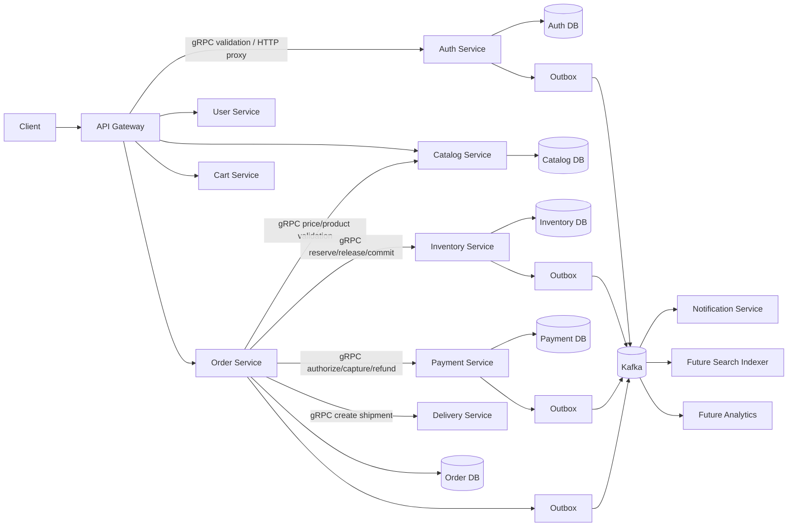
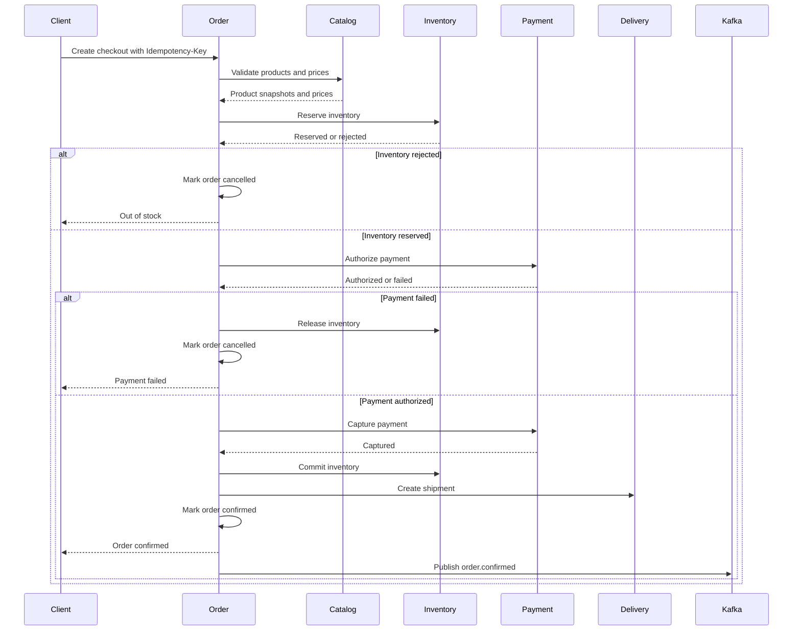
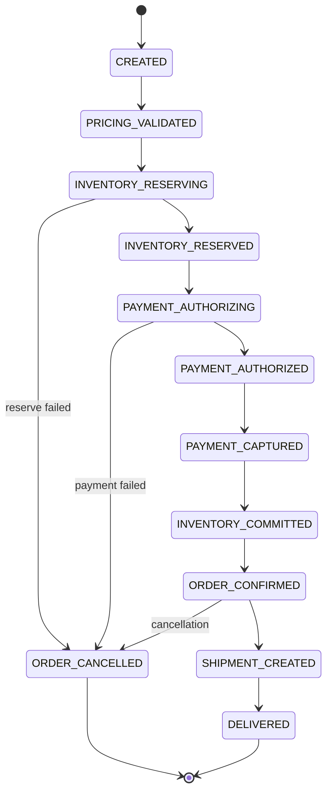
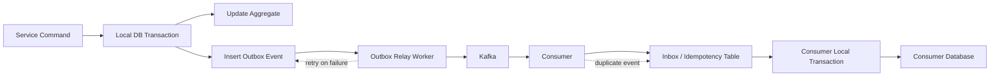

# LahziCart

LahziCart is an ecommerce backend built with Go microservices. Each business capability owns its application code, database schema, migrations, and HTTP API. The API Gateway is the public entry point, while Kafka is used for asynchronous business events.

## Technology

- Go 1.24.12
- Echo HTTP services
- PostgreSQL with pgx
- Goose database migrations
- Redis for authentication token and OTP state
- Kafka through the shared segmentio/kafka-go abstraction
- Zap logging and Prometheus metrics
- Go workspace with service-local modules and a shared module

## Architecture

    Client
       |
       v
    API Gateway :7070
       |
       +--> Auth :7700 -------- PostgreSQL + Redis
       +--> User :7701 -------- PostgreSQL
       +--> Catalog :7702 ----- PostgreSQL
       +--> Inventory :7703 --- PostgreSQL
       +--> Cart :7704 -------- PostgreSQL
       +--> Order :7705 ------- PostgreSQL
       +--> Payment :7706 ----- PostgreSQL
       +--> Notification :7707 - PostgreSQL
       +--> Delivery :7708 ---- PostgreSQL

    Auth, User, Order, Inventory, and Payment
       | publish domain events
       v
    Kafka --------------> Notification and downstream workflows

Synchronous operations use HTTP through the gateway. Asynchronous workflows use Kafka events. Each service has its own database and migration directory.

## Service Communication Design

LahziCart uses gRPC for synchronous service-to-service commands and queries, and Kafka for asynchronous domain events. PostgreSQL remains the source of truth inside each service.

### Communication Topology



### Protocol Responsibilities

| Operation | Protocol | Reason |
| --- | --- | --- |
| JWT validation | gRPC | Immediate response is required |
| Product price validation | gRPC | Checkout needs current catalog data |
| Inventory reservation | gRPC command | Checkout needs success or failure immediately |
| Payment authorization | gRPC command | Order needs a payment decision |
| Shipment creation | gRPC command | Order needs a creation result |
| Order created | Kafka event | Multiple services may consume it |
| Payment succeeded/failed | Kafka event | Notifications and fulfillment consume it |
| Inventory reserved/released | Kafka event | Audit and downstream workflows consume it |
| Search index update | Kafka event | Indexing should not block catalog writes |
| Notification delivery | Kafka consumer | Delivery needs retry and DLQ handling |

Do not use a probabilistic filter as the source of truth for stock, price, authorization, or order validation. Exact decisions must be made by the owning service.

### Checkout Saga Sequence



### Saga State Machine



Compensating actions:

- Inventory failure: cancel the order.
- Payment failure: release inventory and cancel the order.
- Payment timeout: retry, then expire and release inventory.
- Cancellation after authorization: void or refund payment and release inventory.
- Delivery failure: retry shipment or create an operations task.

### Transactional Outbox Flow



The aggregate update and outbox insert commit together. A relay publishes the event later. Consumers record the event ID before applying business effects, so Kafka redelivery does not duplicate the operation.

### Event Envelope

All Kafka events should use a common envelope:

```json
{
  "event_id": "uuid",
  "event_type": "inventory.reserved",
  "version": 1,
  "aggregate_type": "order",
  "aggregate_id": "order-uuid",
  "saga_id": "saga-uuid",
  "correlation_id": "request-uuid",
  "producer": "inventory-service",
  "occurred_at": "2026-11-25T12:00:00Z",
  "payload": {}
}
```

Use the aggregate ID as the Kafka message key. For order events, the key should be order_id so events for one order remain ordered within a Kafka partition.

### gRPC Contract Rules

Every gRPC request should propagate:

    authorization
    x-request-id
    x-correlation-id
    x-saga-id
    x-idempotency-key

Every method must define timeout, retry policy, error mapping, idempotency behavior, ownership checks, and whether retry is safe. Retry only transient failures such as Unavailable, ResourceExhausted, and idempotent DeadlineExceeded operations.

Recommended status mapping:

| gRPC status | Meaning |
| --- | --- |
| InvalidArgument | Invalid request |
| Unauthenticated | Missing or invalid authentication |
| PermissionDenied | User lacks permission |
| NotFound | Entity does not exist |
| AlreadyExists | Duplicate resource |
| FailedPrecondition | Business state prevents operation |
| Aborted | Concurrency conflict |
| ResourceExhausted | Out of stock or rate limited |
| Unavailable | Temporary service failure |
| DeadlineExceeded | Timeout |

### Required gRPC Contracts

Catalog:

    GetProduct(product_id)
    GetProductPrice(product_id)
    ValidateProducts(product_ids)
    GetProductSnapshot(product_ids)

Inventory:

    ReserveInventory(order_id, items, idempotency_key)
    ReleaseInventory(order_id)
    CommitInventory(order_id)
    CheckAvailability(product_id, quantity)

Payment:

    AuthorizePayment(order_id, amount, idempotency_key)
    CapturePayment(payment_id, idempotency_key)
    VoidPayment(payment_id, idempotency_key)
    RefundPayment(payment_id, amount, idempotency_key)
    GetPaymentStatus(payment_id)

Delivery:

    CreateShipment(order_id, address, idempotency_key)
    GetShipment(order_id)

## Services

| Service | Port | Responsibility | Database |
| --- | ---: | --- | --- |
| api-gateway | 7070 | Public routing, reverse proxy, JWT validation | None |
| auth-service | 7700 | Registration, login, OTP, refresh, logout, JWT validation | user_auth |
| user-service | 7701 | User profiles and lifecycle | user-service |
| catalog-service | 7702 | Products, images, reviews, ratings, filtering | catalog |
| inventory-service | 7703 | Stock, adjustments, reservations, releases | inventory |
| cart-service | 7704 | Carts and cart items | cart |
| order-service | 7705 | Orders, order items, status, cancellation | orders |
| payment-service | 7706 | Payment records and payment status | payment |
| notification-service | 7707 | Notification persistence and event consumers | notification |
| delivery-service | 7708 | Shipments, tracking, and delivery status | delivery |

The implemented delivery service is delivery-service. The older delivery-serivce directory is an unused misspelled scaffold.

## End-to-End Flow

### Authentication

1. The client calls /api/auth/* on the gateway.
2. The gateway forwards the request to auth-service.
3. Auth stores credentials in PostgreSQL and token/OTP state in Redis.
4. Login returns access and refresh tokens.
5. Protected gateway routes validate the access JWT using JWT_SECRET.

Auth endpoints:

    POST /api/auth/register
    POST /api/auth/login
    POST /api/auth/send-otp
    POST /api/auth/login-with-phone
    POST /api/auth/refresh-token
    GET  /api/auth/logout

### Catalog, Cart, and Checkout

1. Product reads go through GET /api/products or GET /api/products/:id.
2. Catalog reads products, images, and reviews from its own database.
3. An authenticated user creates or reads a cart through /api/carts.
4. Cart stores cart ownership and item quantities without duplicating catalog ownership.
5. Checkout creates an order through POST /api/orders. Clients should send an `Idempotency-Key` header; repeated requests with the same key and body return the original order, while reusing a key with a different body returns `409 Conflict`.
6. Order service stores the order and items, then publishes order.created.
7. Inventory reserves stock and publishes inventory.reserved, or releases it with inventory.released.
8. Payment status changes publish payment.succeeded or payment.failed.
9. Notification service consumes order/payment events and stores notification records.
10. Delivery service manages shipment creation, tracking, and delivery status.

### Kafka Topics

| Topic | Producer | Purpose |
| --- | --- | --- |
| user.created | Auth | Create the user profile |
| user.updated | User | Synchronize auth data |
| user.deleted | User | Clean up auth data |
| order.created | Order | Start checkout downstream work |
| order.cancelled | Order | Release or cancel downstream work |
| inventory.reserved | Inventory | Confirm stock reservation |
| inventory.released | Inventory | Confirm stock release |
| inventory.adjusted | Inventory | Publish stock changes |
| payment.succeeded | Payment | Confirm successful payment |
| payment.failed | Payment | Notify payment failure |

The shared Kafka consumer retries failed handlers with exponential backoff and publishes failed messages to <topic>.dlq. Kafka metrics are exposed through the shared observability package.

## Gateway Routes

The gateway listens on http://localhost:7070.

Service health endpoints use `/health` for process liveness and `/ready` for dependency readiness. User-service and notification-service currently verify PostgreSQL connectivity before returning `200 READY`.

## Request Correlation

The API Gateway establishes `X-Request-ID` and `X-Correlation-ID` at the edge and forwards them through reverse-proxy requests. Shared service middleware accepts or generates the same correlation ID and returns it in the response. Checkout requests may provide `X-Saga-ID`; when absent, order-service creates one and returns it. The resulting correlation and Saga IDs are included in the versioned `order.created` event envelope.

| Gateway route | Authentication |
| --- | --- |
| /api/auth/* | Public/auth endpoints |
| GET /api/products and GET /api/products/* | Public |
| /api/users/* | JWT required |
| Product mutations under /api/products/* | JWT required |
| /api/inventory/* | JWT required |
| /api/carts/* | JWT required |
| /api/orders/* | JWT required |
| /api/payments/* | JWT required |
| /api/notifications/* | JWT required |
| /api/deliveries/* | JWT required |
| /health | Public |
| /swagger/* | Public |

The gateway removes the public prefix and forwards requests to the service-local route prefix using httputil.NewSingleHostReverseProxy.

## Project Structure

    LahziCart/
    ├── Services/
    │   ├── api-gateway/
    │   ├── auth-service/
    │   ├── user-service/
    │   ├── catalog-service/
    │   ├── inventory-service/
    │   ├── cart-service/
    │   ├── order-service/
    │   ├── payment-service/
    │   ├── notification-service/
    │   └── delivery-service/
    ├── shared/
    │   ├── config/
    │   ├── events/
    │   ├── messaging/kafkaBroker/
    │   ├── middleware/
    │   ├── observability/
    │   ├── response/
    │   └── proto/
    ├── scripts/
    │   ├── run-all-services.sh
    │   └── <service>/migration.sh
    ├── go.work
    └── Makefile

The service implementation pattern is:

    cmd/server/main.go
      config -> database/cache/kafka -> repository -> service -> handler -> router -> Echo

Most services use config, db/migration, models, repository, service, handler, and router packages under internal.

## Prerequisites

- Go 1.24.12
- PostgreSQL
- Redis
- Kafka at localhost:9092
- Goose CLI
- Bash, Git Bash, WSL, or another Bash-compatible shell

The sample local configuration uses PostgreSQL user postgres and password root. Change the service .env files for your environment.

## Configuration

Each service loads .env from its own directory. A database-backed service uses:

    APP_NAME=Catalog
    APP_PORT=7702
    DB_HOST=localhost
    DB_PORT=5432
    DB_USER=postgres
    DB_PASSWORD=root
    DB_NAME=catalog

Kafka-enabled services also use:

    KAFKA_BROKERS=localhost:9092

Auth additionally requires SECRET_KEY, REFRESH_KEY, REDIS_HOST, REDIS_PORT, GRPC_PORT, and EXPIRE_IN.

The gateway must have URLs for all routed services:

    APP_PORT=7070
    JWT_SECRET=change-me
    AUTH_SERVICE_URL=http://localhost:7700
    USER_SERVICE_URL=http://localhost:7701
    PRODUCT_SERVICE_URL=http://localhost:7702
    INVENTORY_SERVICE_URL=http://localhost:7703
    CART_SERVICE_URL=http://localhost:7704
    ORDER_SERVICE_URL=http://localhost:7705
    PAYMENT_SERVICE_URL=http://localhost:7706
    NOTIFICATION_SERVICE_URL=http://localhost:7707
    DELIVERY_SERVICE_URL=http://localhost:7708

## Migrations

Each service owns its migrations. Use the repository scripts:

    make migrate SERVICE=catalog-service ACTION=up
    make migrate SERVICE=catalog-service ACTION=down

To create a new migration, run Goose from the target service:

    cd Services/catalog-service
    goose -dir internal/db/migration create add_catalog_field sql

Then add SQL to the generated -- +goose Up and -- +goose Down sections.

## Running the Project

Start every service:

    make run-all

This runs scripts/run-all-services.sh, starts each cmd/server process from its service directory, staggers startup, and stops all child processes when Ctrl+C is pressed.

Start one service:

    cd Services/catalog-service
    go run ./cmd/server

Health checks:

    curl http://localhost:7070/health
    curl http://localhost:7702/health

## Observability

The shared middleware package provides request IDs, structured logging, panic recovery, timeout handling, CORS, rate limiting, validation, and Prometheus HTTP metrics. Auth also starts a Prometheus endpoint on port 9090.

Responses use the shared format:

    {
      "message": "product found",
      "data": {}
    }

Paginated endpoints include a pagination object.

## Development Checks

    gofmt -w Services shared
    go test ./...

Individual modules can also be tested from their service directory:

    cd Services/order-service
    go test ./...

The project currently has compile coverage and limited unit-test coverage. Full integration testing requires PostgreSQL, Redis, Kafka, applied migrations, and running services.

## Current Scope

Implemented capabilities include authentication, users, catalog, inventory, cart, orders, payments, notifications, delivery, gateway routing, database migrations, Kafka abstractions, and shared middleware.

The gateway configuration also contains reserved fields for future wishlist, search, recommendation, analytics, admin, and standalone review services. Those services are not currently implemented or routed.
